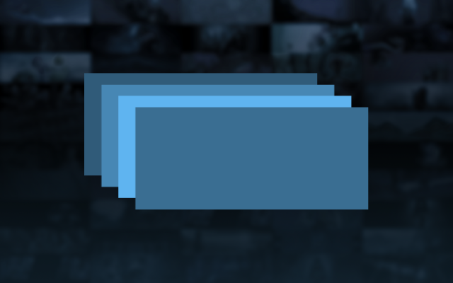
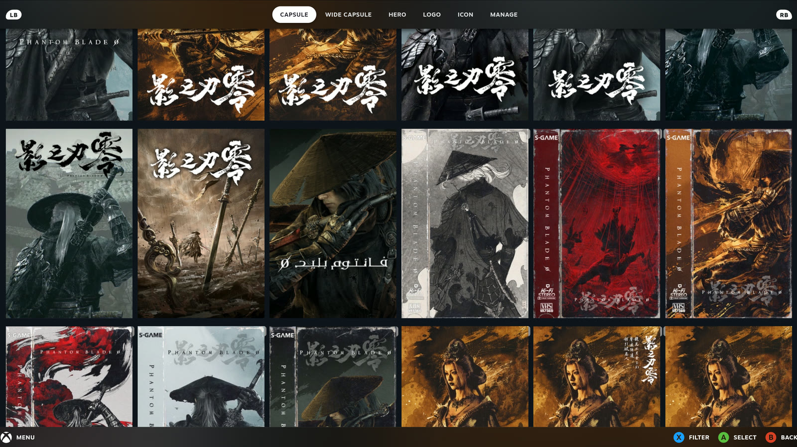
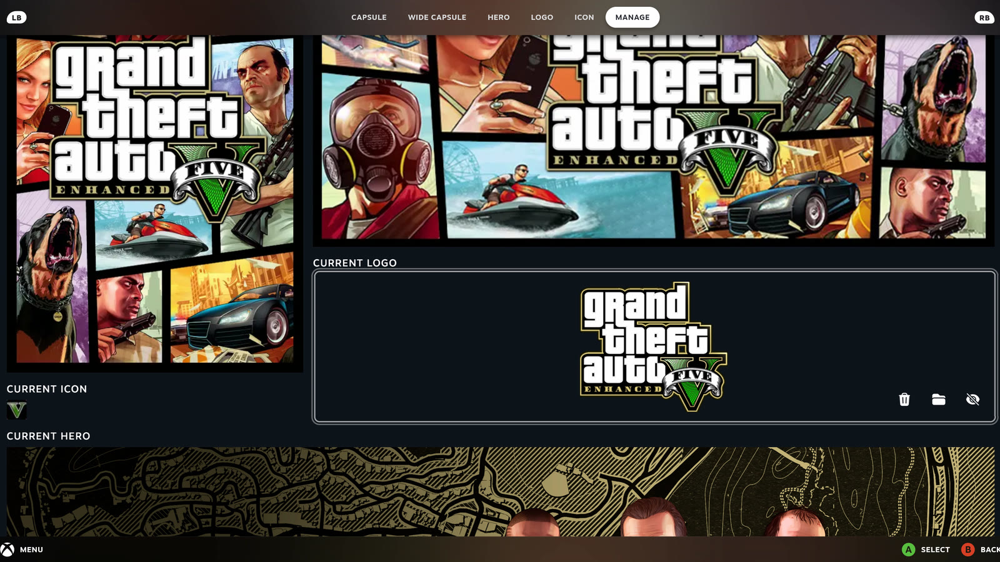
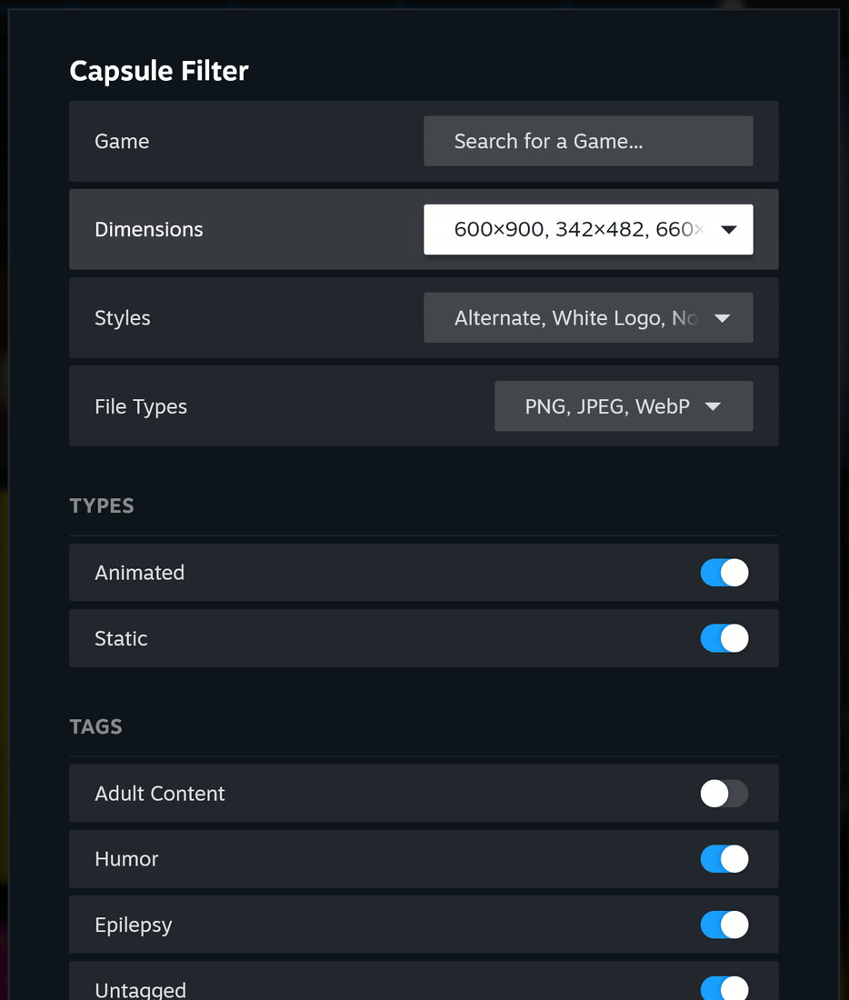
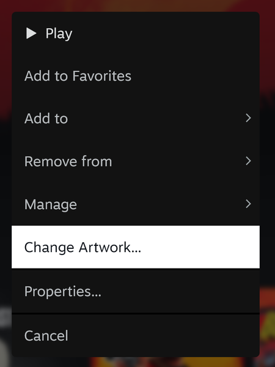
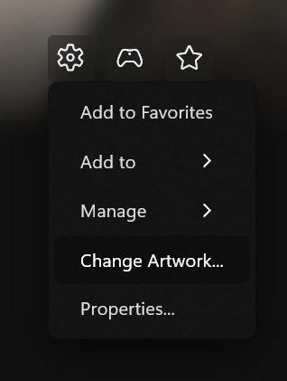
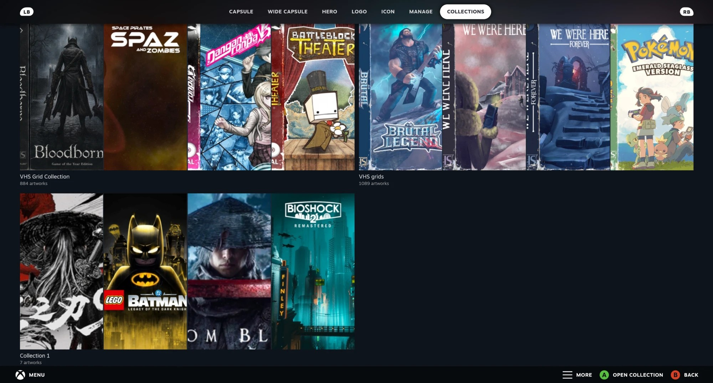
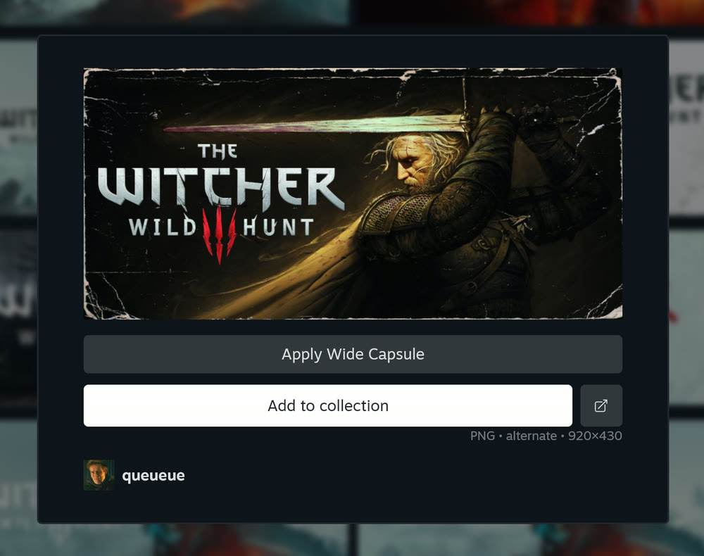
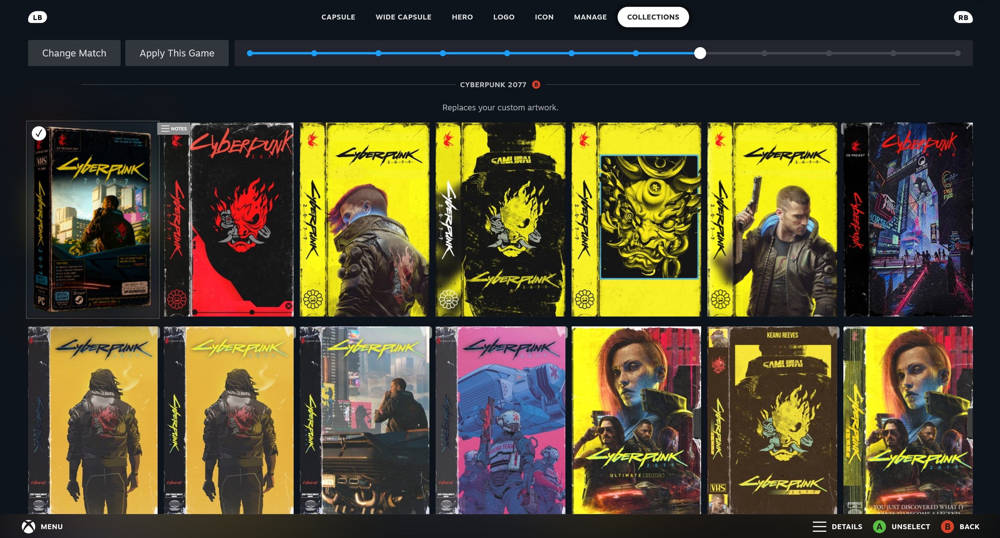
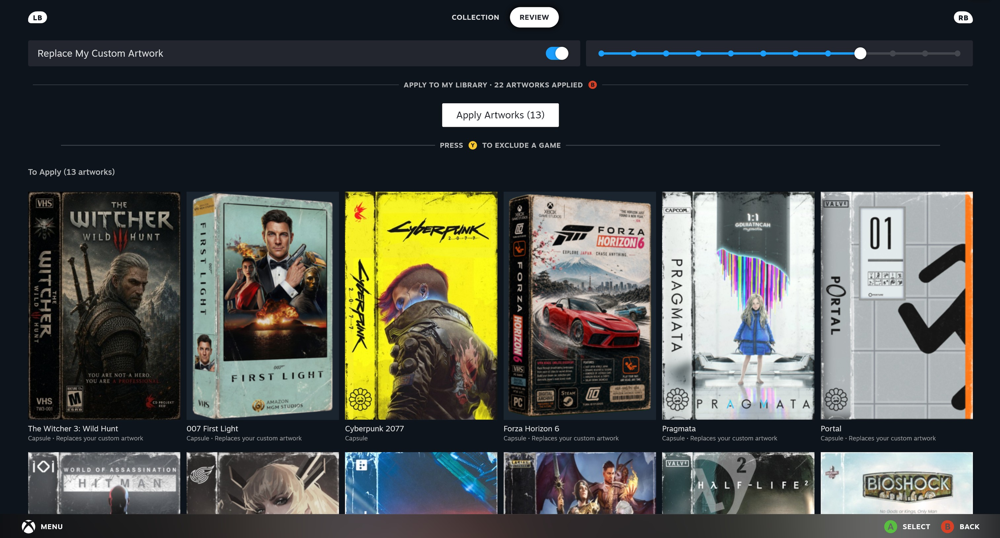

 

<h1 align="center"> SteamGridDB plugin for Millennium | UnOfficial </h1>

Give every game in your Steam library the artwork it deserves. Browse SteamGridDB's huge catalog of capsules, heroes, logos and icons, use your own images, or restyle your whole library from a single collection, all without leaving Big Picture or the Steam desktop.

 

## Features
- Browse capsules, wide capsules, heroes, logos and icons from SteamGridDB for the selected game.
- Filter results by style, dimensions, file type, animation and tags.
- Restyle your whole library with a SteamGridDB [collection](#collections).
- Support for non-Steam shortcuts and Source/GoldSrc mods.
- Manually select images from the local file system, or use Steam's official artwork.
- Utility to apply invisible assets.
- Logo anchor point positioner and resizer.
- Square capsules.
- Change capsule type of recently played game.
- Works in Big Picture and on the Steam desktop.

## Usage
Select **Change Artwork...** from a game's menu: right-click a game on the desktop, or focus it in Big Picture and press <picture><source media="(prefers-color-scheme: dark)" srcset="docs/start-light.svg"><source media="(prefers-color-scheme: light)" srcset="docs/start-dark.svg"></picture>. The <picture><source media="(prefers-color-scheme: dark)" srcset="docs/menucog-light.svg"><source media="(prefers-color-scheme: light)" srcset="docs/menucog-dark.svg"></picture> button on a game page has it too. On the desktop, the plugin opens in its own window.

 

## Collections
Pick any SteamGridDB collection, and the **Collections** tab goes through all of it for you: it finds every game in it that you own, lets you choose between versions, and keeps the artwork you set yourself. You see every change before anything is written, then your whole library is restyled in one go.

### Pick a collection
Open one of your own SteamGridDB collections, or add any public collection by pasting its link or ID. Each collection opens as a grid of its games, and games you don't own are dimmed.

You can also fill your own collections as you browse: open any artwork's details (press <picture><source media="(prefers-color-scheme: dark)" srcset="docs/start-light.svg"><source media="(prefers-color-scheme: light)" srcset="docs/start-dark.svg"></picture> on it, or right-click it on the desktop) and select **Add to collection**.

 

### Choose your favorites
Some games have more than one version in a collection. Open a game to pick the one you want, or leave it for later: **Choose** walks you through every game still waiting, one at a time. Short on patience? **Use First for the Rest** takes the first version for every game left.

Already applied a collection and want different picks? **Choose Again** on the review page asks you about those games again. If a game isn't recognized, **Match to Library** on its page points it at the right game you own.

### Review every change
**Apply to My Library** shows every game that will change before anything is written. Artwork you set yourself stays unless you turn on **Replace My Custom Artwork**, and pressing <picture><source media="(prefers-color-scheme: dark)" srcset="docs/y-light.svg"><source media="(prefers-color-scheme: light)" srcset="docs/y-dark.svg"></picture> on a game (or selecting **Exclude** on its tile) leaves it out.

When it looks right, select **Apply**. You can watch the progress or cancel, and if anything fails, **Apply** again retries only those games.

Applied artwork has no undo, but any single image can be reset from the Manage tab. Collections are read from SteamGridDB's undocumented website API, and the tab is in English only for now.

## Settings
Settings are in Millennium's plugin settings on the desktop, and in Big Picture's Quick Access menu if you use the optional [Plugins Hub](https://github.com/DevsNate/PluginsHub-Millennium) plugin. Besides your API Key, they cover Asset Tab Settings (reorder or hide tabs, and choose the one that opens first), Hide Authors, Square Capsules, Matching Recents Capsule and Capsule Glow. Every tab also has a size slider for how many items fit in a row.

> [!NOTE]
> This is an **<ins>unofficial</ins>** port of [SteamGridDB's plugin for Decky Loader](https://github.com/SteamGridDB/decky-steamgriddb), adapted to run on Windows in Steam's Big Picture and Desktop mode through [Millennium](https://steambrew.app). All credit for the plugin goes to SteamGridDB and its contributors; please report problems with this fork [here](https://github.com/DevsNate/SteamGridDB-Millennium/issues), not upstream.

## SteamGridDB API Key
The plugin uses your own SteamGridDB API Key, which is free with a SteamGridDB account. The first time you open the plugin, it asks for one: **Get Key** opens your [SteamGridDB API preferences](https://www.steamgriddb.com/profile/preferences/api), then paste the Key and select **Save Key**. If SteamGridDB ever rejects it, the same screen comes back. The Key is stored locally, in plain text, in `Steam/millennium/plugins/SteamGridDB/settings.json`.

## Installation
1. Install [Millennium](https://steambrew.app)
2. Download the latest release from [Releases](https://github.com/DevsNate/SteamGridDB-Millennium/releases)
3. Copy `steamgriddb.star` into `Steam/millennium/plugins` (requires a Starlight-capable Millennium, verified with v3.6.2)
4. Restart Steam and enable SteamGridDB in Millennium's plugin settings

## Files the plugin writes
Besides the artwork you apply, the plugin only writes to `Steam/millennium/plugins/SteamGridDB/`:

| File | What it holds |
|---|---|
| `settings.json` | Your API Key |
| `applied_artwork.json` | Which SteamGridDB artwork each game shows, so Collections can tell it from your own |
| `game_links.json` | Which Steam app each SteamGridDB game links to |
| `collections/<id>.json` | Saved copies of the 20 most recently opened collections |

## Building from source
See [DEVELOPMENT.md](DEVELOPMENT.md) for building, the project layout and updating from upstream.

## Credits
**Original plugin:** [SteamGridDB](https://github.com/SteamGridDB/decky-steamgriddb), with early testing by Emenesu and Mr. Mendelli and development help from the [SDH Discord](https://discord.gg/ZU74G2NJzk)  
**Millennium port:** [DevsNate](https://github.com/DevsNate)

## License
[GPL-3.0-or-later](LICENSE), the same as [the original plugin](https://github.com/SteamGridDB/decky-steamgriddb). The libraries in `frontend/vendor/` keep their own licenses; see [its README](frontend/vendor/README.md).
