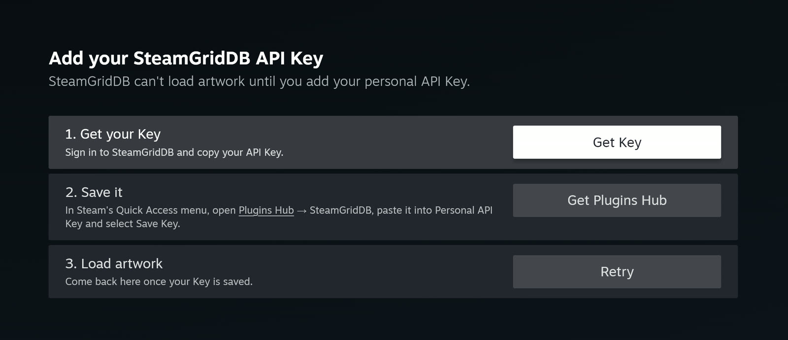
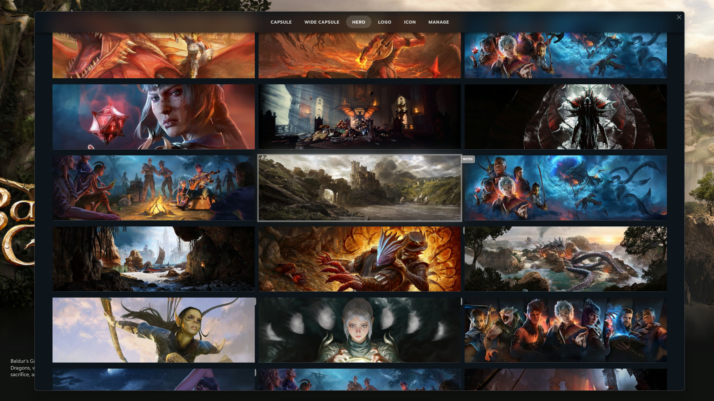
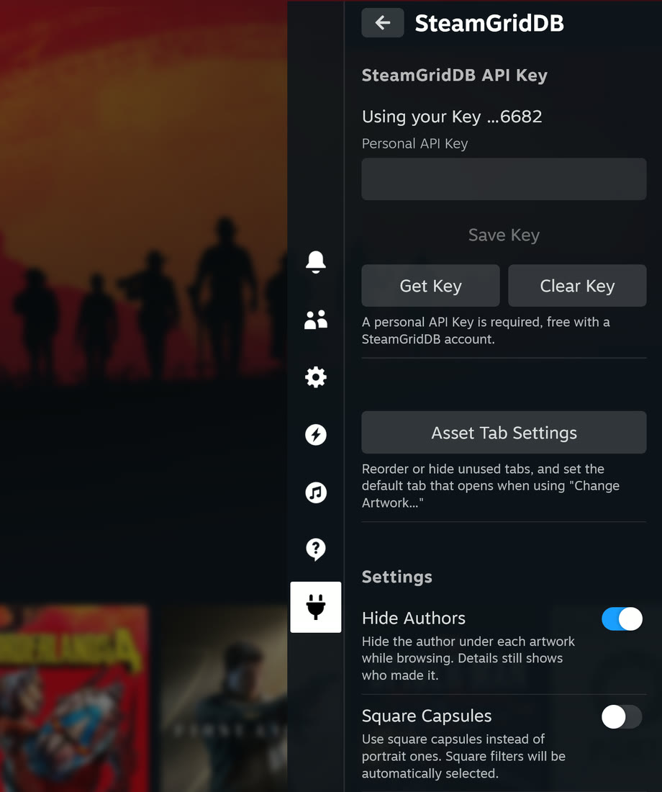

<div align="center">


[](LICENSE) 
</div>

<h1 align="center"> SteamGridDB plugin for Millennium | UnOfficial </h1>

> [!NOTE]
> This is an **<ins>unofficial</ins>** port of [SteamGridDB's plugin for Decky Loader](https://github.com/SteamGridDB/decky-steamgriddb), adapted to run on Windows in Steam's Big Picture and Desktop mode through [Millennium](https://steambrew.app). All credit for the plugin goes to SteamGridDB and its contributors; please report problems with this fork [here](https://github.com/DevsNate/SteamGridDB-Millennium/issues), not upstream.

Easily browse and manage Steam artwork from SteamGridDB or your local files, in Big Picture or on the Steam desktop.


 

## Usage
Select "Change Artwork..." from a game context menu. On the Steam desktop, the same menu entry opens the plugin in a separate window.  

You can open the menu by right-clicking a game on the desktop, or in Big Picture by focusing on a game and pressing <picture><source media="(prefers-color-scheme: dark)" srcset="docs/start-light.svg"><source media="(prefers-color-scheme: light)" srcset="docs/start-dark.svg"></picture>.  
The <picture><source media="(prefers-color-scheme: dark)" srcset="docs/menucog-light.svg"><source media="(prefers-color-scheme: light)" srcset="docs/menucog-dark.svg"></picture> button on a game page opens it in both.

 

The first time you open it, the plugin asks for your SteamGridDB API Key. Get Key opens SteamGridDB's API page. Paste the Key into the plugin's settings, then select Retry. The same screen comes back if SteamGridDB rejects a saved Key.

To reach the settings from Big Picture's Quick Access menu, you need the [Plugins Hub](https://github.com/DevsNate/PluginsHub-Millennium) plugin. Without it, add the Key from Millennium's settings / sidebar on the Steam desktop.



## Features
- Browse assets from SteamGridDB for the selected game.
- Support for non-Steam shortcuts and Source/GoldSrc mods.
- Ability to change icons for Steam or non-Steam shortcuts.
- Manually select images from the local file system.
- Utility to apply invisible assets.
- Logo anchor point positioner and resizer.
- Square capsules.
- Change capsule type of recently played game.

### Added in this port
- A matching artwork window on the Steam desktop, with mouse and keyboard controls.
- "Change Artwork..." in the game context menu on the Steam desktop as well as in Big Picture.
- Add artwork to your SteamGridDB collections, or open it on SteamGridDB, from its details.
- Hide artwork authors while browsing (on by default).
- Your API Key stays in the Lua backend; the settings only show its last four characters.
- A size slider on every tab that sets how many items fit in a row.
- Reset puts back a Steam game's original icon.
- New icons for non-Steam shortcuts show right away, without restarting Steam.



 

## Installation
1. Install [Millennium](https://steambrew.app)
2. Download the latest release from [Releases](https://github.com/DevsNate/SteamGridDB-Millennium/releases)
3. Copy `steamgriddb.star` into `Steam/millennium/plugins` (requires a Starlight-capable Millennium, verified with v3.6.2)
4. Restart Steam and enable SteamGridDB in Millennium's plugin settings

### SteamGridDB API Key
The Millennium version uses your own SteamGridDB API Key. Get one from your [SteamGridDB API preferences](https://www.steamgriddb.com/profile/preferences/api), then enter it in the plugin's settings: Millennium's sidebar on the desktop, or Quick Access → Plugins Hub → SteamGridDB in Big Picture (this needs the [Plugins Hub](https://github.com/DevsNate/PluginsHub-Millennium) plugin). The Key is stored locally in `Steam/millennium/plugins/SteamGridDB/settings.json` and never reaches the plugin's frontend.

### Settings
The same settings page has Asset Tab Settings (reorder or hide tabs, choose the default one), Hide Authors (on by default), Square Capsules, Matching Recents Capsule and Capsule Glow. They are saved in Millennium's plugin config.

## Building
```bash
pnpm install
pnpm run build
```
The package is written to `dist/steamgriddb.star`; building does not install it
or restart Steam. A plain `starlight pack -o dist` (with `dist/` already created)
also builds it with no install, which is how Millennium's plugin database builds
plugins: the small libraries are committed in `frontend/vendor/` and the compiled
upstream SCSS in `frontend/generated/`.

| Command | What it does |
|---|---|
| `pnpm dev` | Rebuilds on change |
| `pnpm check` | Runs every check in `scripts/checks/`; build first. The serve-patch check uses the installed Steam client (set `STEAM_PATH` if it isn't in the default folder) and skips without one |
| `pnpm styles` | Recompiles `src/styles/` after changing it; `pnpm check` fails while the CSS is out of date |
| `pnpm vendor` | Regenerates `frontend/vendor/` after a dependency or icon change |

Don't run `starlight lsp` here: it overwrites the `paths` in `tsconfig.json` that
map `@decky/*` and the small libraries to this repository's copies.

## Project layout
```
backend/main.lua          Lua backend: API Key, SteamGridDB requests, icons, packed
                          assets, and the patches applied to Steam's sp.js as it's served
frontend/                 The Millennium side
  index.tsx               Entry point: route, popout, functions the sp.js patches call
  artwork-page.tsx        Upstream's page, behind the API Key gate
  details-actions.tsx     Collections and the SteamGridDB link in the Details dialog
  desktop-window/         Big Picture's look inside a desktop window
  library/                Lifecycle of upstream's library patches
  settings/               Settings store and panel, API Key setup view
  steam/                  Serve-time hook targets, Steam windows, tabs, routing
  services/               Backend calls, packed assets, icon conversion
  shims/                  @decky/api, @decky/ui and react-markdown on top of Millennium
  vendor/, generated/     Committed libraries and compiled CSS (both generated)
src/                      Upstream's code, same layout; edits marked // Millennium:
assets/                   Images packed into the .star
scripts/                  Generators, sync-upstream, and checks/
```

## Updating from upstream
This port is based on [decky-steamgriddb](https://github.com/SteamGridDB/decky-steamgriddb);
`package.json` records the upstream version and commit under `"upstream"`.
`src/` keeps upstream's layout, and every change to it is marked `// Millennium:`.
```bash
pnpm sync-upstream          # upstream's main, or: pnpm sync-upstream <branch|tag|commit>
```
This three-way applies upstream's `src/` changes, leaves conflict markers where
they meet a `// Millennium:` edit, lists what has to be ported by hand (the
Python backend goes to `backend/main.lua`, upstream's `src/index.tsx` to
`frontend/index.tsx`) and the dependency changes, then records the new base.
Nothing is committed. Finish with `pnpm build && pnpm check`.

# Credits
**Original plugin:** [SteamGridDB](https://github.com/SteamGridDB/decky-steamgriddb), with early testing by Emenesu and Mr. Mendelli and development help from the [SDH Discord](https://discord.gg/ZU74G2NJzk)  
**Millennium port:** [DevsNate](https://github.com/DevsNate)

# License
[GPL-3.0-or-later](LICENSE), the same as [the original plugin](https://github.com/SteamGridDB/decky-steamgriddb). The libraries in `frontend/vendor/` keep their own licenses; see [its README](frontend/vendor/README.md).
